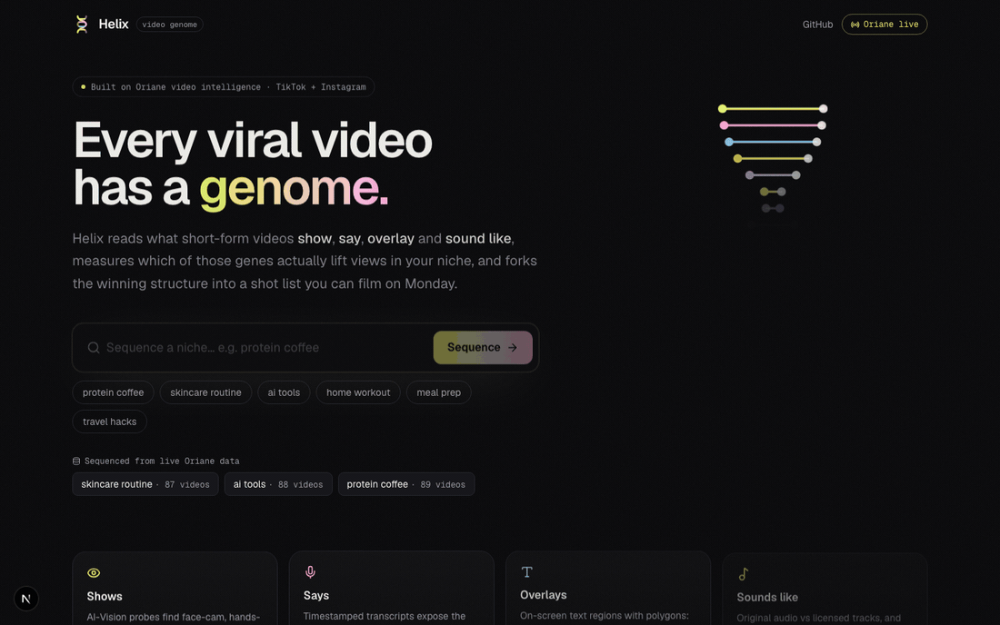
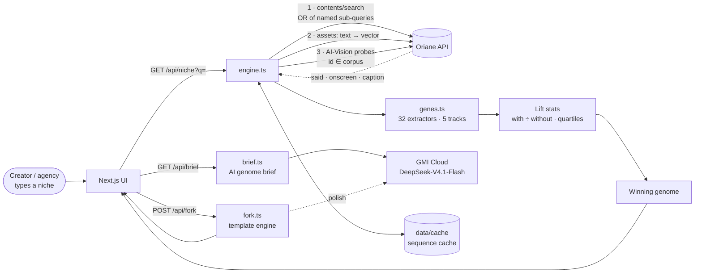

<div align="center">


# Helix

### Every viral video has a genome. Helix sequences it.

**Helix reads what short-form videos _show_, _say_, _overlay_ and _sound like_, measures which of those "genes" actually lift views in your niche, and forks the winning structure into a shot list you can film on Monday.**

[](https://www.oriane.xyz)
[](https://nextjs.org)
[](https://react.dev)
[](https://www.typescriptlang.org)
[](LICENSE)
[](https://luma.com/92iq2a12)

[](https://vercel.com/new/clone?repository-url=https%3A%2F%2Fgithub.com%2Fvnmoorthy%2Fhelix&root-directory=app&env=ORIANE_API_KEY&envDescription=Oriane%20REST%20API%20key&envLink=https%3A%2F%2Fapp.oriane.xyz%2Fbilling%2Fsubscription%3Ftab%3Dapi&project-name=helix)
[](https://github.com/vnmoorthy/helix/releases/latest)
[](https://github.com/vnmoorthy/helix/actions/workflows/ci.yml)
[](https://github.com/vnmoorthy/helix/stargazers)

### [▶ Try the live demo → vnmoorthy.github.io/helix](https://vnmoorthy.github.io/helix/)

[**Quickstart**](#-quickstart) · [**Real findings**](#-real-findings-from-live-oriane-data) · [**How it works**](#-how-it-works) · [**Architecture**](#-architecture) · [**The 32 genes**](#-the-gene-catalog) · [**Pitch deck**](#-pitch-deck) · [**Why Helix**](#-why-this-exists)

<br/>



<sub>Sequence a niche → see the winning genome → filter by gene → open a 5-track video genome → fork it into a shot list. All on live Oriane data.</sub>

</div>

---

## ✨ What it does in one screen


Type a niche — `protein coffee`, `ai tools`, `skincare routine` — and Helix:

1. **Sequences it.** Pulls the hits and the long tail for that niche from [Oriane](https://www.oriane.xyz)'s TikTok + Instagram index. Videos are found three ways at once: by what's **said**, what's **written on screen**, and what's **captioned**. Six AI-Vision probes then tag what's **shown**. For every video we know _how_ it was found, so Helix can tell you what share of the niche is invisible to caption-based tools.
2. **Extracts 32 genes per video** across five tracks — **Visual · Spoken · On-screen · Sound · Format**. Every gene carries a timestamp and the exact Oriane field it was read from. Nothing on screen is guessed by an LLM.
3. **Measures lift.** For every gene: median views-per-follower _with_ vs _without_ it, plus its share of top-quartile vs bottom-quartile videos. The **winning genome** is the strongest lifting gene per track.
4. **Briefs you.** An LLM on **GMI Cloud** (DeepSeek-V4.1-Flash) reads *only* the measured lift numbers and the top videos' real opening lines, then writes a Monday brief: the headline finding, 3 moves with their numbers, 1 thing to stop, and 3 hooks that fit the genome.
5. **Forks it.** Turn the winning genome (or any single video's genome) into a 4-beat shot list — HOOK · SETUP · PROOF · CTA — that **inherits the structure and swaps every piece of content**. Or batch-fork it across your whole creator roster in one click.

> **Structure, never content.** Songs share chord progressions; videos can share genomes. Helix never copies footage, words or music — it copies what works.

---

## 📊 Real findings from live Oriane data

Sequenced live from Oriane's TikTok + Instagram index on **Nov 6 2026**:

<table>
<tr><td width="50%">

**`protein coffee`** · 11,401 matching videos · 89 sequenced · 497M views

| Gene | Lift | Top vs bottom quartile |
|---|---|---|
| ⏱ 30–60s length | **7.2×** | 59% vs 4% |
| 🎵 Licensed music | **5.7×** | 18% vs 5% |
| 📝 Long story caption | **4.2×** | 63% vs 21% |
| 🔤 Text-heavy overlays | **3.4×** | 77% vs 45% |
| 🗣 Contrarian hook | **1.8×** | 9% vs 5% |

**84%** of these videos never mention "protein coffee" in their caption. They were found through what's **said** (32) or **written on screen** (70). A caption-only tool finds **14**.

</td><td width="50%">


</td></tr>
</table>

> Lift = median views-per-follower of videos **with** the gene ÷ **without** it. Correlation with receipts, not causation. Every fork is a testable hypothesis.

---

## 🧬 The video genome


Click any video to open its genome: a five-track timeline of **frames** (with AI-Vision hits), **transcript chunks**, **on-screen text** (OCR polygons drawn on the frame), **sound** (original / licensed / trending) and **format**, followed by every detected gene with its evidence, source field and niche-level lift.

## 🍴 Fork → shot list → Monday


- **One creator:** "What's your video about?" → a filmable 4-beat shot list with shot, line, overlay and sound per beat, inherited-gene badges, and a genome lift score.
- **Agency roster:** paste `handle, product` for 5 or 50 creators → one proven genome becomes 50 Monday briefs. Export all as Markdown.
- **Export:** copy as Markdown, download `.md`, or print.
- **LLM polish on GMI Cloud:** with `GMI_API_KEY` set, Helix rewrites the spoken lines and overlays in the creator's voice **while keeping every gene fixed** (DeepSeek-V4.1-Flash, about 5s). `ANTHROPIC_API_KEY` or `OPENAI_API_KEY` also work. With no key, the deterministic template engine runs.

---

## 🎤 Pitch deck

A 10-slide motion-graphics deck lives in [`deck/`](deck/):

- **[`deck/index.html`](deck/index.html)**: present from the browser. Use ← → / Space to move, `F` for fullscreen and `N` for speaker notes with a timer.
- **[`deck/helix-deck.pptx`](deck/helix-deck.pptx)**: the PowerPoint version, with transitions, entrance animations and speaker notes.
- **[`docs/STORYBOARD.md`](docs/STORYBOARD.md)**: a word-for-word 3-minute pitch script with demo beats, plus Q&A prep.

---

## 🚀 Quickstart

```bash
git clone https://github.com/vnmoorthy/helix.git
cd helix/app
npm install
cp .env.example .env.local   # add ORIANE_API_KEY (get one at app.oriane.xyz → Billing → API)
npm run dev                  # http://localhost:3000
```

No key yet? Helix still runs end to end on a seeded **sample corpus**, clearly labelled `SAMPLE DATA` everywhere it appears. You can also paste your key in the app (**Connect Oriane**, localhost only) and it is written to `.env.local`.

| Env var | Required | What it does |
| --- | --- | --- |
| `ORIANE_API_KEY` | for live data | Oriane REST key — every sequence calls `connect.oriane.xyz/rest` |
| `GMI_API_KEY` | recommended | GMI Cloud inference for the **AI genome brief** and **fork polish** |
| `GMI_MODEL` / `GMI_BASE_URL` / `GMI_REASONING_EFFORT` | optional | Defaults: `deepseek-ai/DeepSeek-V4.1-Flash`, `https://api.gmi-serving.com/v1`, `none` (skips hidden reasoning, so answers come in about 1.5s) |
| `ANTHROPIC_API_KEY` / `ANTHROPIC_MODEL` | optional | LLM polish via Claude |
| `OPENAI_API_KEY` | optional | LLM polish via OpenAI |

**Live demo (GitHub Pages):** [vnmoorthy.github.io/helix](https://vnmoorthy.github.io/helix/) is a static edition. It serves niches pre-sequenced from live Oriane data, with **GMI Cloud genome briefs generated at build time** and the fork engine running in your browser. It never ships an API key. Rebuild it with `bash app/scripts/build-pages.sh` and publish `app/out` to the `gh-pages` branch. Live sequencing of *any* niche runs in the server version (local or Vercel).

**Deploy your own:** click **Deploy with Vercel** above (root directory `app`, set `ORIANE_API_KEY`), or run `bash app/scripts/deploy.sh`. The repo ships recorded live sequences for `protein coffee`, `ai tools` and more in `app/data/cache/`, so a fresh deployment opens real data instantly.

**Deep links** (great for demos): `/n?q=protein%20coffee&video=top` opens the top video's genome · `/n?q=protein%20coffee&fork=1&product=oat-milk%20cold%20brew&creator=maya.lifts` opens a generated fork · `?gene=text.hook` filters the wall.

---

## 🔬 How it works



### 1 · One query, three text signals
Helix sends Oriane `contents/search` requests whose root is an `or` of **named** sub-queries: `said` (`transcript.includesFuzzy`), `onscreen` (`onScreenText.includesFuzzy`) and `caption` (`caption.includesFuzzy`). Oriane returns `matchedQueries` per video, so Helix knows _why_ each video is in the corpus. That powers the **"invisible to caption search"** KPI: the share of the niche that a caption/hashtag tool would never find.

Two pages are pulled in parallel, both ranked by `viewsCount:desc` but far apart (rank 1–45 and rank 120–165). That covers the hits **and** the long tail with fully processed videos, so lift compares like with like. Videos Oriane hasn't processed yet (no frames, no transcript) are dropped before scoring, and only videos with 5K+ views from the last 12 months count.

### 2 · AI-Vision gene probes
Six text assets (`face to camera`, `hands holding a product`, `screen recording`, `outdoors`, `bold text card`, `before/after split`) are created once and cached. For each one, Helix runs a `visualSimilarity` search **restricted to the corpus IDs** (`id.includes`, `minScore 0.12`), so each visual gene is tagged only on videos Oriane's vision model actually matched.

### 3 · Deterministic gene extraction
`lib/genes.ts` turns each video into genes with evidence. Examples:

| Gene | Track | Read from | Evidence shown |
| --- | --- | --- | --- |
| Question hook | Spoken | `transcriptChunks[0]` | “Why is nobody telling you this…?” @ 0:00 |
| Talks in < 0.5s | Spoken | `transcriptChunks[0].startSeconds` | First word at 0.2s |
| Fast pace | Spoken | `transcriptChunks` | 3.6 words/sec over 13s |
| Text hook in frame 1 | On-screen | `frames[].onScreenTextRegions` | “PROTEIN COFFEE HACK” at 0.0s |
| Burned-in captions | On-screen | `onScreenText × transcript` | 78% of overlay words match speech |
| Trending sound | Sound | `audioTitle` | “APT.” reused across this niche |
| Hands + product | Visual | `visualSimilarity` probe | Matched “hands holding a product close to the camera” |
| Under 10s | Format | `media.duration` | 8s |

### 4 · Lift, not vibes
```
lift(gene) = median(views/follower | video has gene) ÷ median(views/follower | video lacks gene)
```
Views-per-follower normalises away creator size (a 10M-follower account isn't "better hooks"). Each gene also shows **n**, its share of the niche, and its share of the **top vs bottom quartile**. Genes need n ≥ 2 on both sides to be scored. The **winning genome** takes the best gene per track (two for Spoken and Format), respecting mutually exclusive groups (you can't be both "under 10s" and "60s+").

> Helix shows correlation with receipts, not causation. Every fork is a testable hypothesis, and the "genome lift score" on a fork is a geometric blend of the inherited genes' lifts — a prior, not a promise.

### 5 · AI genome brief (GMI Cloud)
`lib/brief.ts` sends GMI Cloud's DeepSeek-V4.1-Flash the ranked gene table (lift, n, quartile shares), the underperforming genes, and the real opening lines (spoken plus on-screen) of the top 8 videos. The prompt allows only claims that cite those numbers. The JSON brief is cached per niche next to its sequence, and for the static site it is generated at build time by `scripts/precompute.ts`.

### 6 · Fork engine
`lib/fork.ts` maps genes onto four beats. For example `hook.question` + `hook.you` → _“Why is nobody telling you this about {product}?”_; `text.hook` + `text.caps` → an ALL-CAPS headline burned onto frame one; `vis.hands` → _“Extreme close-up: your hands bring {product} into frame”_; `sound.trending` → the niche's most reused track. Every beat lists the genes it inherits and the content it swaps.

---

## 🏗 Architecture


```
helix/
├── app/                         # Next.js 16 app (App Router, React 19, Tailwind v4)
│   ├── app/
│   │   ├── page.tsx             # landing + niche search
│   │   ├── g/[q]/page.tsx       # niche genome report
│   │   └── api/
│   │       ├── niche/route.ts   # GET  → NicheReport (sequence + genes + lift)
│   │       ├── fork/route.ts    # POST → ForkPlan (template + GMI polish)
│   │       ├── brief/route.ts   # GET  → AI genome brief (GMI Cloud)
│   │       ├── status/route.ts  # GET  → live/sample, LLM, cached niches
│   │       └── key/route.ts     # POST → set ORIANE_API_KEY (localhost only)
│   ├── components/
│   │   ├── NicheView.tsx        # KPIs, signal provenance, winning genome, leaderboard, wall
│   │   ├── GenomeStrip.tsx      # 5-track video genome + OCR polygons + gene evidence
│   │   ├── ForkPanel.tsx        # fork + agency roster + export
│   │   └── ui.tsx               # design system, helix art, status, badges
│   ├── lib/
│   │   ├── oriane.ts            # typed Oriane REST client (auth auto-detect)
│   │   ├── engine.ts            # orchestration, AI-Vision probes, cache
│   │   ├── genes.ts             # 32-gene catalog, extractors, lift statistics
│   │   ├── fork.ts              # shot-list engine + GMI polish
│   │   ├── brief.ts             # AI genome brief (grounded in lift stats)
│   │   ├── llm.ts               # GMI Cloud / Claude / OpenAI client
│   │   ├── client.ts            # browser data layer (server or static mode)
│   │   ├── sample.ts            # seeded sample corpus (no-key mode)
│   │   └── types.ts
│   └── data/cache/              # recorded live sequences (demo-proof)
├── deck/                        # 10-slide motion pitch deck (HTML + PPTX)
└── docs/                        # banner, architecture, screenshots, storyboard
```

**Design choices**
- **Server-only keys.** The Oriane key never reaches the browser; `/api/key` refuses non-localhost hosts.
- **Auth auto-detect.** `lib/oriane.ts` tries `Authorization: Bearer` then `x-api-key` and remembers which one works.
- **Demo-proof.** Every live sequence is written to `data/cache/<niche>.json`, so a niche sequenced once on good wifi replays instantly on stage. **Re-sequence live** forces a fresh call.
- **Honest UI.** Source badges everywhere: `LIVE · Oriane API`, `Oriane data · sequenced <time>`, or `SAMPLE DATA`.

---

## 🧪 The gene catalog

| Track | Genes |
| --- | --- |
| **Visual** (AI Vision) | Face to camera · Hands + product · Screen recording · Outdoors · Text card · Before / after |
| **Spoken** (transcript) | Question hook · Direct "you" hook · Listicle hook · Contrarian hook · "I tried" experiment · Talks in < 0.5s · Fast pace (3+ w/s) · No voice · Spoken CTA |
| **On-screen** (OCR) | Text hook in frame 1 · Burned-in captions · Text-heavy · ALL-CAPS overlay · POV / framing text · No overlay |
| **Sound** (audio) | Original audio · Licensed music · Trending sound (reused across the niche) |
| **Format** | Under 10s · 10–30s · 30–60s · 60s+ · Short caption · Long story caption · No hashtags · 5+ hashtags |

Adding a gene is one entry in `GENES` plus a few lines in `extractGenes()`. PRs welcome.

---

## 💡 Why this exists

Every creator asks the same question every Monday: **_what should I post?_** The answers they get are vibes: "use a strong hook", "add captions", "jump on trends". Agencies running 50 creators pay strategists to watch hundreds of videos by hand. Social-listening tools read captions and hashtags, but most of what makes a video work lives in what it **shows, says, overlays and sounds like**. Oriane reports that **76% of brand exposure in video lives in what creators say and show, not what they tag.**

Helix makes those signals measurable, per niche, with receipts.

| Who | Monday-morning job | Helix |
| --- | --- | --- |
| **Creator** | "What do I film this week?" | Winning genome + a shot list for your product |
| **Agency (50 creators)** | 50 briefs by 10am | Roster batch-fork, export all |
| **Brand / DTC** | "What content works in our category?" | Category genome + caption-blind-spot KPI |

**Business model:** Creator Pro **$19/mo** · Agency **$499/mo per 50-creator roster** · Brand/API usage-based on top of Oriane credits.
**Moat:** a growing gene-lift dataset per niche — every sequence sharpens the priors — that only multimodal indexing makes possible.

### How the idea was chosen
Ten ideas were red-teamed by **100 judge-persona agents** modelled on the five Hack the Feed judges (20 personas each, each scoring all 10 ideas on the five official criteria), followed by an adversarial deep-dive on the top three. Helix (then "Format Genome") won **39/100 first-place votes** (next best: 14) and scored **9.1/10 on usage of video intelligence data**. The critics' main attack, "fork-a-video is already on the organizer's list", shaped the product: Helix measures genes **across the niche** with lift numbers, and forks **structure, never content**.

---

## 🗺 Roadmap
- [ ] Genome diff: your last 30 videos vs the niche's winning genome ("you never open with a text hook")
- [ ] Weekly re-sequence + Slack/Notion Monday brief for agencies
- [ ] Shot-boundary genes (cut pacing) once frame-level scene cuts are exposed
- [ ] Oriane MCP server integration so agents can call `sequence_niche` / `fork_genome`
- [ ] A/B tracking: did forked videos beat the creator's own median?

## ⭐ Star history

[](https://star-history.com/#vnmoorthy/helix&Date)

## 🤝 Contributing
New genes are the best contributions. See [CONTRIBUTING.md](CONTRIBUTING.md). The one rule: every gene must be read from an Oriane field and come with evidence.

## 🙏 Credits
Built solo in one afternoon at **[Hack the Feed](https://luma.com/92iq2a12)** (Amplitude HQ, San Francisco, Nov 6 2026) on top of **[Oriane](https://www.oriane.xyz)** video intelligence, with thanks to **Lovable**, **GMI Cloud**, **Compound** and **Amplitude**.

## 📄 License
MIT © 2026 [vnmoorthy](https://github.com/vnmoorthy)
