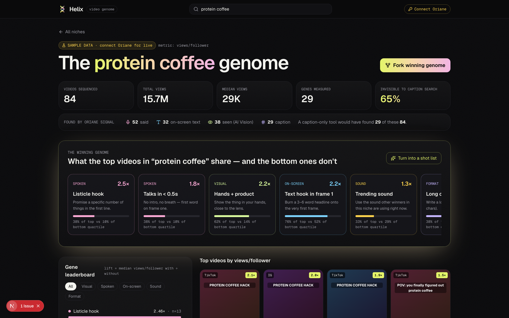
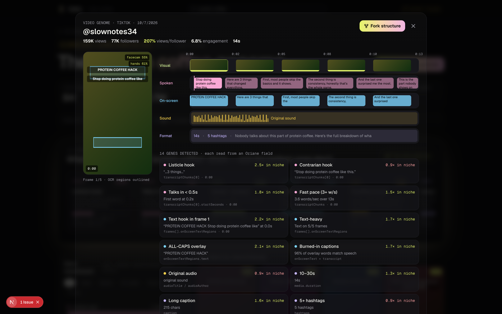
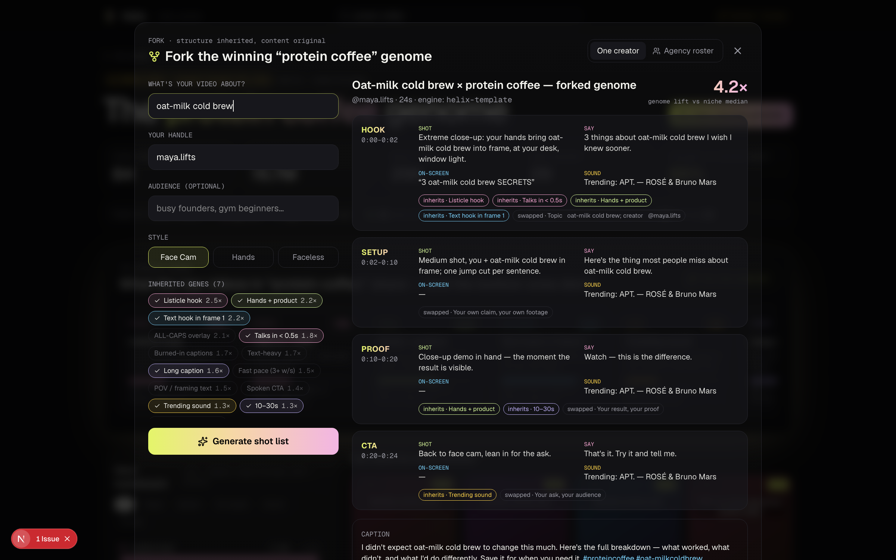
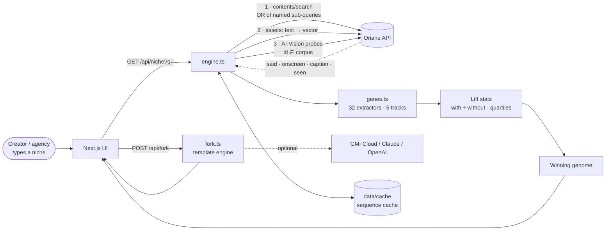
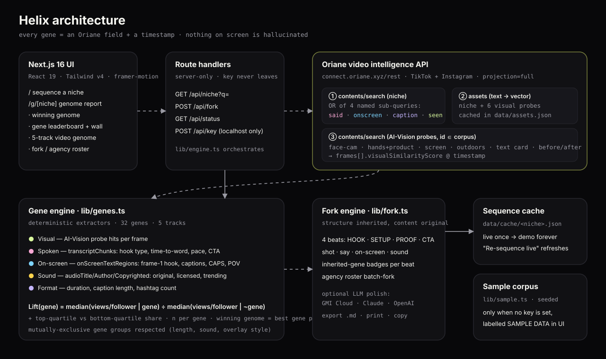

<div align="center">



# Helix

### Every viral video has a genome. Helix sequences it.

**Helix reads what short-form videos _show_, _say_, _overlay_ and _sound like_, measures which of those "genes" actually lift views in your niche, and forks the winning structure into a shot list you can film on Monday.**

[](https://www.oriane.xyz)
[](https://nextjs.org)
[](https://react.dev)
[](https://www.typescriptlang.org)
[](LICENSE)
[](https://luma.com/92iq2a12)

[**Quickstart**](#-quickstart) · [**How it works**](#-how-it-works) · [**Architecture**](#-architecture) · [**The 32 genes**](#-the-gene-catalog) · [**Pitch deck**](deck/) · [**Why Helix**](#-why-this-exists)

</div>

---

## ✨ What it does in one screen



Type a niche — `protein coffee`, `ai tools`, `skincare routine` — and Helix:

1. **Sequences it.** Pulls the top and the most recent videos for that niche from [Oriane](https://www.oriane.xyz)'s TikTok + Instagram index, found four different ways at once: by what's **said**, what's **written on screen**, what's **captioned**, and what's **seen** by AI Vision. For every video we know _how_ it was found, so Helix can tell you what share of the niche is invisible to caption-based tools.
2. **Extracts 32 genes per video** across five tracks — **Visual · Spoken · On-screen · Sound · Format**. Every gene carries a timestamp and the exact Oriane field it was read from. Nothing on screen is guessed by an LLM.
3. **Measures lift.** For every gene: median views-per-follower _with_ vs _without_ it, plus its share of top-quartile vs bottom-quartile videos. The **winning genome** is the strongest lifting gene per track.
4. **Forks it.** Turn the winning genome (or any single video's genome) into a 4-beat shot list — HOOK · SETUP · PROOF · CTA — that **inherits the structure and swaps every piece of content**. Or batch-fork it across your whole creator roster in one click.

> **Structure, never content.** Songs share chord progressions; videos can share genomes. Helix never copies footage, words or music — it copies what works.

---

## 🧬 The video genome



Click any video to open its genome: a five-track timeline of **frames** (with AI-Vision hits), **transcript chunks**, **on-screen text** (OCR polygons drawn on the frame), **sound** (original / licensed / trending) and **format**, followed by every detected gene with its evidence, source field and niche-level lift.

## 🍴 Fork → shot list → Monday



- **One creator:** "What's your video about?" → a filmable 4-beat shot list with shot, line, overlay and sound per beat, inherited-gene badges, and a genome lift score.
- **Agency roster:** paste `handle, product` for 5 or 50 creators → one proven genome becomes 50 Monday briefs. Export all as Markdown.
- **Export:** copy as Markdown, download `.md`, or print.
- **Optional LLM polish:** set `GMI_API_KEY` (GMI Cloud inference), `ANTHROPIC_API_KEY` or `OPENAI_API_KEY` and Helix rewrites the spoken lines in the creator's voice **while keeping every gene fixed**. With no key it uses the deterministic template engine.

---

## 🚀 Quickstart

```bash
git clone https://github.com/vnmoorthy/helix.git
cd helix/app
npm install
cp .env.example .env.local   # add ORIANE_API_KEY (get one at app.oriane.xyz → Billing → API)
npm run dev                  # http://localhost:3000
```

No key yet? Helix still runs end to end on a seeded **sample corpus**, clearly labelled `SAMPLE DATA` everywhere it appears. You can also paste your key in the app (**Connect Oriane**, localhost only) and it is written to `.env.local`.

| Env var | Required | What it does |
| --- | --- | --- |
| `ORIANE_API_KEY` | for live data | Oriane REST key — every sequence calls `connect.oriane.xyz/rest` |
| `GMI_API_KEY` / `GMI_MODEL` / `GMI_BASE_URL` | optional | LLM polish for forks via GMI Cloud (OpenAI-compatible) |
| `ANTHROPIC_API_KEY` / `ANTHROPIC_MODEL` | optional | LLM polish via Claude |
| `OPENAI_API_KEY` | optional | LLM polish via OpenAI |

**Deep links** (great for demos): `/g/protein%20coffee?video=top` opens the top video's genome · `?fork=1&product=oat-milk%20cold%20brew&creator=maya.lifts` opens a generated fork · `?gene=text.hook` filters the wall.

---

## 🔬 How it works



### 1 · One query, four signals
Helix sends **one** Oriane `contents/search` request whose root is an `or` of four **named** sub-queries — `said` (`transcript.includesFuzzy`), `onscreen` (`onScreenText.includesFuzzy`), `caption` (`caption.includesFuzzy`) and `seen` (`visualSimilarity` against a text asset of the niche). Oriane returns `matchedQueries` per video, so Helix knows _why_ each video is in the corpus. That powers the **"invisible to caption search"** KPI: the share of the niche a caption/hashtag tool would never find.

Two pages are pulled in parallel — `sort=viewsCount:desc` (the winners) and `sort=publishedAt:desc` (the long tail) — so lift is measured across the whole performance range, not just the hits.

### 2 · AI-Vision gene probes
Six text assets (`face to camera`, `hands holding a product`, `screen recording`, `outdoors`, `bold text card`, `before/after split`) are created once and cached. For each, Helix runs a `visualSimilarity` search **restricted to the corpus IDs** (`id.includes`) and reads `frames[].visualSimilarityScore` to tag the visual gene on the exact frame.

### 3 · Deterministic gene extraction
`lib/genes.ts` turns each video into genes with evidence. Examples:

| Gene | Track | Read from | Evidence shown |
| --- | --- | --- | --- |
| Question hook | Spoken | `transcriptChunks[0]` | “Why is nobody telling you this…?” @ 0:00 |
| Talks in < 0.5s | Spoken | `transcriptChunks[0].startSeconds` | First word at 0.2s |
| Fast pace | Spoken | `transcriptChunks` | 3.6 words/sec over 13s |
| Text hook in frame 1 | On-screen | `frames[].onScreenTextRegions` | “PROTEIN COFFEE HACK” at 0.0s |
| Burned-in captions | On-screen | `onScreenText × transcript` | 78% of overlay words match speech |
| Trending sound | Sound | `audioTitle` | “APT.” reused across this niche |
| Hands + product | Visual | `frames[].visualSimilarityScore` | AI Vision 61% at 0.0s |
| Under 10s | Format | `media.duration` | 8s |

### 4 · Lift, not vibes
```
lift(gene) = median(views/follower | video has gene) ÷ median(views/follower | video lacks gene)
```
Views-per-follower normalises away creator size (a 10M-follower account isn't "better hooks"). Each gene also shows **n**, its share of the niche, and its share of the **top vs bottom quartile**. Genes need n ≥ 2 on both sides to be scored. The **winning genome** takes the best gene per track (two for Spoken and Format), respecting mutually exclusive groups (you can't be both "under 10s" and "60s+").

> Helix shows correlation with receipts, not causation. Every fork is a testable hypothesis, and the "genome lift score" on a fork is a geometric blend of the inherited genes' lifts — a prior, not a promise.

### 5 · Fork engine
`lib/fork.ts` maps genes onto four beats. For example `hook.question` + `hook.you` → _“Why is nobody telling you this about {product}?”_; `text.hook` + `text.caps` → an ALL-CAPS headline burned onto frame one; `vis.hands` → _“Extreme close-up: your hands bring {product} into frame”_; `sound.trending` → the niche's most reused track. Every beat lists the genes it inherits and the content it swaps.

---

## 🏗 Architecture



```
helix/
├── app/                         # Next.js 16 app (App Router, React 19, Tailwind v4)
│   ├── app/
│   │   ├── page.tsx             # landing + niche search
│   │   ├── g/[q]/page.tsx       # niche genome report
│   │   └── api/
│   │       ├── niche/route.ts   # GET  → NicheReport (sequence + genes + lift)
│   │       ├── fork/route.ts    # POST → ForkPlan (template, optional LLM)
│   │       ├── status/route.ts  # GET  → live/sample, LLM, cached niches
│   │       └── key/route.ts     # POST → set ORIANE_API_KEY (localhost only)
│   ├── components/
│   │   ├── NicheView.tsx        # KPIs, signal provenance, winning genome, leaderboard, wall
│   │   ├── GenomeStrip.tsx      # 5-track video genome + OCR polygons + gene evidence
│   │   ├── ForkPanel.tsx        # fork + agency roster + export
│   │   └── ui.tsx               # design system, helix art, status, badges
│   ├── lib/
│   │   ├── oriane.ts            # typed Oriane REST client (auth auto-detect)
│   │   ├── engine.ts            # orchestration, AI-Vision probes, cache
│   │   ├── genes.ts             # 32-gene catalog, extractors, lift statistics
│   │   ├── fork.ts              # shot-list engine + LLM polish
│   │   ├── sample.ts            # seeded sample corpus (no-key mode)
│   │   └── types.ts
│   └── data/cache/              # recorded live sequences (demo-proof)
├── deck/                        # 10-slide motion pitch deck (HTML + PPTX)
└── docs/                        # banner, architecture, screenshots, storyboard
```

**Design choices**
- **Server-only keys.** The Oriane key never reaches the browser; `/api/key` refuses non-localhost hosts.
- **Auth auto-detect.** `lib/oriane.ts` tries `Authorization: Bearer` then `x-api-key` and remembers which one works.
- **Demo-proof.** Every live sequence is written to `data/cache/<niche>.json`, so a niche sequenced once on good wifi replays instantly on stage. **Re-sequence live** forces a fresh call.
- **Honest UI.** Source badges everywhere: `LIVE · Oriane API`, `Oriane data · sequenced <time>`, or `SAMPLE DATA`.

---

## 🧪 The gene catalog

| Track | Genes |
| --- | --- |
| **Visual** (AI Vision) | Face to camera · Hands + product · Screen recording · Outdoors · Text card · Before / after |
| **Spoken** (transcript) | Question hook · Direct "you" hook · Listicle hook · Contrarian hook · "I tried" experiment · Talks in < 0.5s · Fast pace (3+ w/s) · No voice · Spoken CTA |
| **On-screen** (OCR) | Text hook in frame 1 · Burned-in captions · Text-heavy · ALL-CAPS overlay · POV / framing text · No overlay |
| **Sound** (audio) | Original audio · Licensed music · Trending sound (reused across the niche) |
| **Format** | Under 10s · 10–30s · 30–60s · 60s+ · Short caption · Long story caption · No hashtags · 5+ hashtags |

Adding a gene is one entry in `GENES` plus a few lines in `extractGenes()`. PRs welcome.

---

## 💡 Why this exists

Every creator asks the same question every Monday: **_what should I post?_** The answers they get are vibes: "use a strong hook", "add captions", "jump on trends". Agencies running 50 creators pay strategists to watch hundreds of videos by hand. Social-listening tools read captions and hashtags, but most of what makes a video work lives in what it **shows, says, overlays and sounds like**. Oriane reports that **76% of brand exposure in video lives in what creators say and show, not what they tag.**

Helix makes those signals measurable, per niche, with receipts.

| Who | Monday-morning job | Helix |
| --- | --- | --- |
| **Creator** | "What do I film this week?" | Winning genome + a shot list for your product |
| **Agency (50 creators)** | 50 briefs by 10am | Roster batch-fork, export all |
| **Brand / DTC** | "What content works in our category?" | Category genome + caption-blind-spot KPI |

**Business model:** Creator Pro **$19/mo** · Agency **$499/mo per 50-creator roster** · Brand/API usage-based on top of Oriane credits.
**Moat:** a growing gene-lift dataset per niche — every sequence sharpens the priors — that only multimodal indexing makes possible.

### How the idea was chosen
Ten ideas were red-teamed by **100 judge-persona agents** modelled on the five Hack the Feed judges (20 personas each, each scoring all 10 ideas on the five official criteria), followed by an adversarial deep-dive on the top three. Helix (then "Format Genome") won **39/100 first-place votes** (next best: 14) and scored **9.1/10 on usage of video intelligence data**. The critics' main attack, "fork-a-video is already on the organizer's list", shaped the product: Helix measures genes **across the niche** with lift numbers, and forks **structure, never content**.

---

## 🗺 Roadmap
- [ ] Genome diff: your last 30 videos vs the niche's winning genome ("you never open with a text hook")
- [ ] Weekly re-sequence + Slack/Notion Monday brief for agencies
- [ ] Shot-boundary genes (cut pacing) once frame-level scene cuts are exposed
- [ ] Oriane MCP server integration so agents can call `sequence_niche` / `fork_genome`
- [ ] A/B tracking: did forked videos beat the creator's own median?

## 🙏 Credits
Built solo in one afternoon at **[Hack the Feed](https://luma.com/92iq2a12)** (Amplitude HQ, San Francisco, Nov 6 2026) on top of **[Oriane](https://www.oriane.xyz)** video intelligence, with thanks to **Lovable**, **GMI Cloud**, **Compound** and **Amplitude**.

## 📄 License
MIT © 2026 [vnmoorthy](https://github.com/vnmoorthy)
